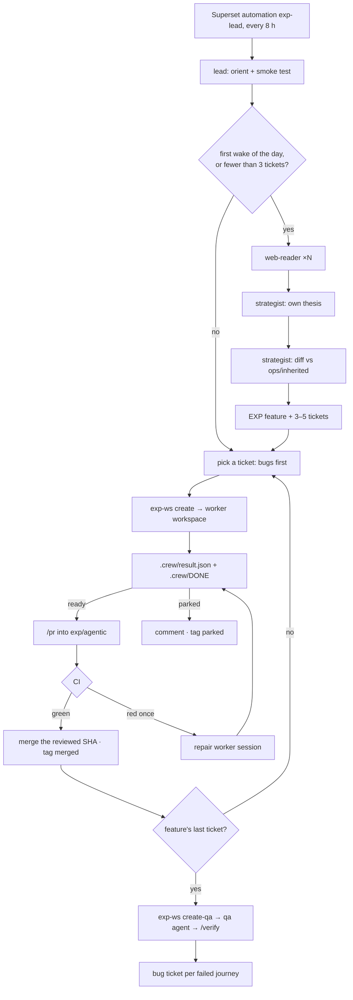
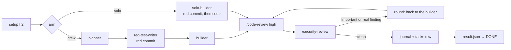

# `.claude/` — the exp crew

This directory is the harness an autonomous crew of Claude Code agents works in, on the branch `exp/agentic`, for one week. The crew researches the market, decides the product, writes EXP tickets in Linear, builds, reviews and merges. Nobody answers questions at run time. `exp/agentic` never merges into `main` and never deploys.

The guards that hold the crew in (hooks, sandbox, launcher, charter) live outside the repo in `~/.agent-harness`, so the crew can't edit them. The interfaces between the parts are in [`ops/CONTRACTS.md`](../ops/CONTRACTS.md).

## One wake

## One ticket (the worker)

Rounds stop at 3. Then the planner re-plans once (solo arm: a fresh solo-builder), then the ticket is parked. Re-reviews read only the new commits.

## Agents

| Agent | Model · effort | Tools | Job |
|---|---|---|---|
| `strategist` | Opus 5.5 · high | WebSearch, WebFetch | thesis, stack review, features; then the diff vs past bets |
| `web-reader` | Haiku 5.5 · high | WebSearch, WebFetch | one research question → sourced rows |
| `planner` | Opus 5.5 · high | Read, Grep, Glob, Bash (read-only) | interfaces and steps with a check each |
| `red-test-writer` | Opus 5.5 · medium | Read, Grep, Glob, Bash, Edit, Write | one failing test per AC + the edge case |
| `builder` | Opus 5.5 · medium | Read, Edit, Write, Bash, Grep, Glob | code until green; fixes findings |
| `solo-builder` | Opus 5.5 · high | same as the builder | plan, red commit and code in one context |
| `qa` | Opus 5.5 · high | repo read, Bash, Linear, `verify` | walks a feature's journeys, files bugs |

The research agents have web tools and nothing else: a poisoned page can't read a secret or write a file.

## Skills

| Skill | Run by | Job |
|---|---|---|
| `lead` | the automation's session | the wake loop |
| `worker` | each workspace session | a ticket, a CI repair, or feature QA |
| `verify` | the `qa` agent | walk journeys, write the report (§4), exit non-zero on a failure |
| `run-coupette` | `verify`, the lead's smoke test | start the app on a throwaway DB and drive it |
| `pr` | the lead | open the PR from §1, without moving the reviewed head |
| `adr` | the planner's plan | record a hard-to-reverse decision |
| `eval-pipeline` | nobody yet | needs embeddings, which this lane lacks |

## Measured on day 7

Cost per merged ticket, CI first-pass rate, reverts, Victor's blind spot-check of 5 PRs, review findings regraded by a stronger model, bugs QA finds per feature, and the strategist's diff against Victor's past docs. Per-ticket rows live in `ops/tasks.jsonl`.
