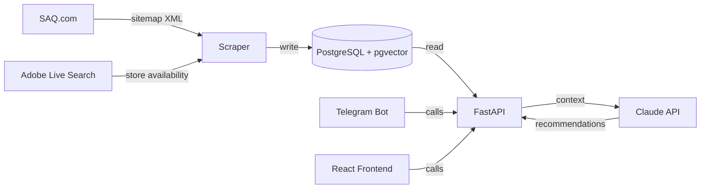

# Coupette

Wine discovery and recommendation platform. Data sourced from the SAQ (Quebec liquor board) catalog.

FastAPI · PostgreSQL + pgvector · Claude API · React · Docker

[](https://github.com/vpatrin/coupette/actions/workflows/ci.yml)
[](CHANGELOG.md)

[](https://docs.astral.sh/ruff/)


- 💬 AI sommelier — intent routing, hybrid search, and conversational recommendations via Claude + pgvector
- 🍷 ~14k wine products scraped from the SAQ public sitemap into PostgreSQL
- 🔍 Catalog API with faceted search, filtering, and restock alerts
- 📍 In-store availability for Montreal stores (daily refresh via SAQ's catalog API)
- 🤖 Telegram bot for restock/destock alerts
- 🌐 Web app at [coupette.club](https://coupette.club) (React + Vite)

## Architecture



*See [docs/ARCHITECTURE.md](docs/ARCHITECTURE.md) for full details.*

## Quick start

```bash
make install              # install all dependencies (Poetry + Yarn)
cp .env.example .env      # fill in values: the file documents itself
make dev                  # DB + migrations + synthetic seed, then backend :8001 + frontend :5173
```

## Development

```bash
make lint          # ruff check
make format        # ruff format
make test          # pytest (all services)
make coverage      # tests + coverage badges
make migrate       # alembic upgrade head + admin user
make build         # docker build
make start-db      # postgres + redis only (shared by every workspace)
```

See [docs/DEVELOPMENT.md](docs/DEVELOPMENT.md) for setup and local workflow.

## Documentation

- [Architecture](docs/ARCHITECTURE.md) — system design, schema boundaries, key decisions
- [Development & Operations](docs/DEVELOPMENT.md) — cold start, infra coupling, deploy, scraper ops, migrations
- [Security](docs/SECURITY.md) — auth model, threat model, CI scanning
- [Engineering](docs/ENGINEERING.md) — engineering targets, benchmarks, and backlog
- [Scaling](docs/SCALING.md) — performance journey: measure, optimize, scale up, scale out
- [Product Vision](docs/PRODUCT_VISION.md) — positioning, core loop, monetization hypotheses
- [Roadmap](docs/ROADMAP.md) — product phases
- [Decisions](docs/adrs/) — ADRs for key technical choices
- [Changelog](CHANGELOG.md) — release history

**Specs:** [Auth](docs/specs/auth.md) · [Chat](docs/specs/chat.md) · [Data Pipeline](docs/specs/scraper.md) · [Recommendations](docs/specs/rag.md) · [Telegram Bot](docs/specs/bot.md) · [Frontend](docs/specs/frontend.md)

## Legal

SAQ data is scraped ethically via their public sitemap (listed in `robots.txt`). Rate-limited to 2s between requests with transparent bot identification.
